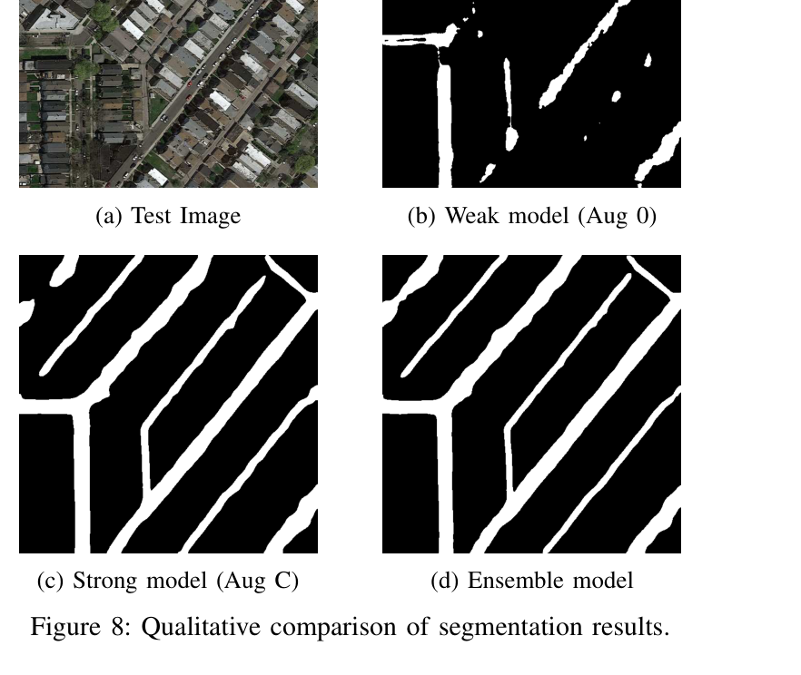
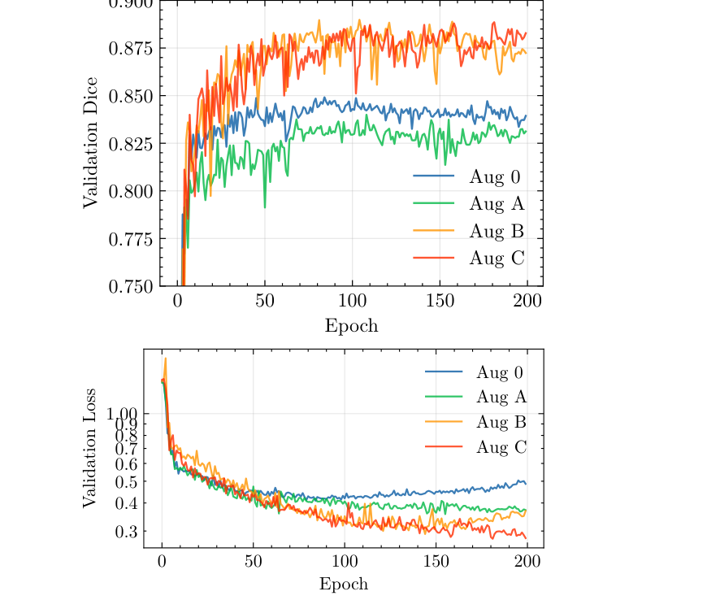

# Road Segmentation from Aerial Imagery

**Deep Residual U-Net · ResNet34 · Ensemble Learning · PyTorch**  
**EPFL CS-433 Machine Learning | 2025 | Team project**

> **Best reported test Dice score: 0.914**, achieved with an ensemble of ResNet34-based U-Net models. Results are reported in our course project paper; model weights and the original dataset are not included in this repository.

## Overview

This project investigates **binary road segmentation from aerial RGB images**. Given a satellite image, the model predicts a pixel-wise mask identifying roads. We studied how encoder architectures, loss functions, data augmentation, and inference strategies affect segmentation accuracy and robustness, especially with limited training data.

The study used **100 annotated 400 × 400 RGB images** from the EPFL CS-433 road-segmentation task. This is a collaborative academic project by **Kamil Chaoui El Faiz, Rhali Tazi, and Tommy Chu**.

## Example predictions



*Qualitative comparison reproduced from Figure 8 of our team project report. The ensemble produces more continuous road masks than the weakly augmented model on this example.*

## Approach

- **Architecture:** a U-Net encoder-decoder with a pretrained **ResNet34** encoder, residual features, and skip connections for spatial detail.
- **Objective:** combined **Binary Cross-Entropy + Dice loss** to balance pixel-level supervision with segmentation overlap.
- **Augmentation:** flips, rotations, brightness/contrast changes, and Gaussian noise, applied during training to improve generalization.
- **Test-time augmentation (TTA):** average predictions over **eight orientations** (four rotations and their mirrored counterparts) after transforming them back to the original orientation.
- **Ensembling:** average probability maps from models trained using different training/validation splits, then threshold to obtain the final mask. The report describes an ensemble of **66 models**.

## Results

Performance reported in the final CS-433 project paper (Dice similarity coefficient):

| Model / experiment | Validation Dice | Test Dice |
|---|---:|---:|
| D-LinkNet34 | 0.868 | 0.890 |
| ResNet34 U-Net | 0.883 | 0.910 |
| **ResNet34 U-Net ensemble** | **0.892** | **0.914** |

Additional findings:

- Strong data augmentation increased **test Dice from 0.844 (without augmentation) to 0.910** in the reported ablation study.
- Test-time augmentation improved the single-model test score from **0.901 to 0.910** in the reported comparison.
- Ensembling improved the reported test score from **0.910 to 0.914**.



*Validation Dice and loss across augmentation policies (from Figure 7 of our report).*

> These figures summarize the **reported experiments**, not a fresh execution of this GitHub snapshot.

## Repository structure

```text
road-segmentation-unet/
├── README.md                 # Project overview and reported results
├── requirements.txt          # Python dependencies (see platform note below)
├── run.py                    # Inference entry point for saved model checkpoints
├── src/
│   ├── model.py              # ResNet34 U-Net architecture
│   ├── train.py              # Training / validation loops
│   ├── dataset.py            # Image and mask loading
│   ├── augmentations.py      # Geometric and photometric augmentation
│   ├── losses.py             # BCE + Dice loss
│   ├── metrics.py            # Segmentation metrics
│   ├── inference.py          # Single-model inference with TTA
│   ├── ensemble_inference.py # Multi-model inference
│   └── tune_threshold.py     # Threshold exploration
└── assets/                   # Figures extracted from the project report
```

## Installation and usage

This repository shares the **implementation**, but **does not bundle the original training/test images, trained checkpoints, or inference cache**.

1. Clone the repository and create a virtual environment:

   ```bash
   git clone https://github.com/kamilchaoui/road-segmentation-unet.git
   cd road-segmentation-unet
   python3 -m venv .venv
   source .venv/bin/activate
   ```

2. Install dependencies:

   ```bash
   pip install -r requirements.txt
   ```

   **Platform note:** the pinned requirements include NVIDIA CUDA packages intended for a compatible Linux environment. On macOS or another platform, install a platform-compatible PyTorch build and adjust dependencies as needed. GPU acceleration is recommended for full training/inference.

3. Obtain the dataset through the original EPFL CS-433 road-segmentation challenge and organize it as expected by `src/dataset.py`:

   ```text
   training/
   ├── images/satImage_001.png, ...
   └── groundtruth/satImage_001.png, ...
   ```

4. To inspect or retrain the models:

   ```bash
   python src/train.py
   ```

   **Note:** this script currently iterates over **65 random seeds** and may save more than one checkpoint per seed. Retraining the full ensemble is computationally expensive.

5. For ensemble inference, provide the test images in `test_set_images/` and the compatible `.pth` checkpoints in `models/`, then create the cache directory and run:

   ```bash
   mkdir -p cache predictions
   python src/ensemble_inference.py
   ```

   The script writes road-mask predictions under `predictions/`. The original dataset and checkpoints are needed to run it; **these commands have not been independently validated against the reported 0.914 score**.

### Reproducibility note

The report documents a **66-model ensemble**, whereas the current `src/train.py` runs **65 seeds**, and `run.py` uses a **hard-coded 66-model denominator**. The published code is therefore best treated as an **academic implementation snapshot**, rather than a fully packaged, one-command reproduction of the reported result. Reconcile checkpoint selection/count before relying on `run.py` to reproduce the final ensemble.

## Team and context

**Authors:** Kamil Chaoui El Faiz · Rhali Tazi · Tommy Chu  
**Course:** CS-433 Machine Learning, École Polytechnique Fédérale de Lausanne (EPFL), 2025.

The methodology, experiments, and results were produced as a **team project**; this repository is presented as a portfolio example of that collaborative work. Figures are adapted directly from the team report.

**Usage note:** The dataset and model weights are not redistributed here. Please respect the original data provider's terms and the team's/course's sharing permissions.
